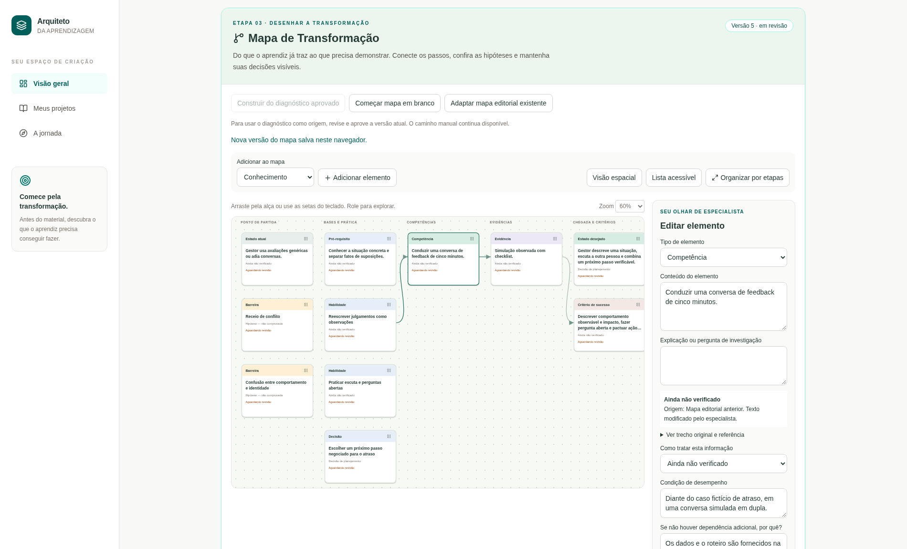
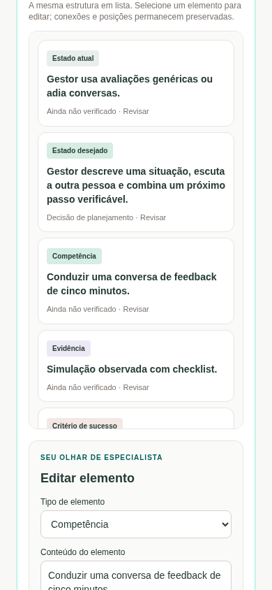
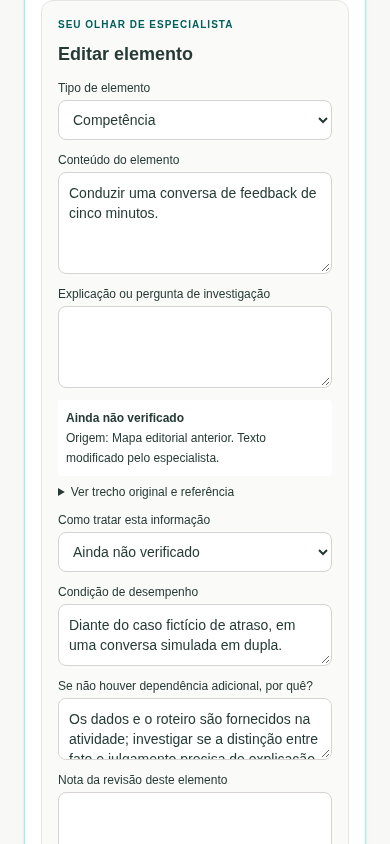

# Entrega da Fase 3 — Mapa de Transformação

## O que ficou pronto

A Fase 2 foi consolidada pelo PR nº 1 na main, após as duas execuções automatizadas passarem. A aprovação do responsável é restrita a piloto assistido com revisão humana obrigatória; o registro está em [assisted-pilot-approval.md](../validation/phase2/assisted-pilot-approval.md). A verificação adicional por IA continua desativada e não recebeu novas chamadas.

A Fase 3 foi implementada separadamente na branch `feat/transformation-map`, para revisão em PR próprio. Não foi integrada à main nesta entrega.

O Mapa de Transformação agora é um editor real, com cartões, conexões, posições, zoom, organização por etapas e alternativa de lista acessível. Representa estados atual e desejado, conhecimentos, habilidades, decisões, pré-requisitos, barreiras, lacunas, pressupostos, competências, evidências e critérios.

## O que a pessoa consegue fazer

1. Abrir o mapa no projeto pelo atalho “Abrir Mapa de Transformação”.
2. Construir uma proposta a partir do diagnóstico atual aprovado, começar manualmente ou adaptar o mapa editorial existente sem alterar o original.
3. Adicionar e editar elementos, consultar o trecho e a referência de origem, registrar dúvidas e marcar a revisão de cada elemento. Hipóteses mantêm seu rótulo; aceitação no planejamento não é comprovação.
4. Conectar competências a evidências/critério e a conhecimentos, habilidades ou decisões pertinentes. Quando não houver dependência adicional necessária, justificar a dispensa em vez de inventar pré-requisitos.
5. Arrastar pela alça, mover com setas do teclado ou botões, organizar por etapas e navegar com zoom/rolagem. No celular, selecionar um cartão leva ao painel de edição.
6. Desconectar relações e remover elementos da proposta atual, preservando versões salvas.
7. Salvar rascunhos e aprovar após a conferência humana. Reabrir o projeto mantém textos, relações, posições, enquadramento e histórico.
8. Restaurar uma versão como novo rascunho, sem apagar o histórico. Mudanças posteriores no diagnóstico/descoberta sinalizam desatualização sem substituir decisões humanas.

O mapa exige competência com condição, evidência e critério relacionados para aprovação. Pontos pendentes são descritos em português, sem nota artificial de aprendizagem. Nem todos os tipos precisam existir em todo projeto: não são criadas decisões ou barreiras apenas para preencher uma estrutura.

## Demonstração visual real: feedback construtivo

As capturas foram produzidas pelo Playwright no navegador Chromium executando a aplicação local. Não são maquetes ou imagens geradas por IA. O cenário é fictício; a demonstração parte do mapa editorial preservado e inclui edição manual de condição de desempenho, inclusão de uma decisão e conexão de uma habilidade à competência. O mapa permanece em revisão; não há aprovação pedagógica automática.

### Computador

### Celular — lista e edição

As dimensões mobile foram emuladas no navegador. Não houve teste em aparelho físico ou sessão de usabilidade com participantes reais. A referência original dos elementos permanece visível no inspetor.

## O que foi testado

- Lint, tipagem e build de produção.
- **55 testes de domínio/integração**, incluindo regressões da Fase 2 e regras de mapa, importação, aprovação, fontes, persistência, limites e projeção para futuros consumidores.
- **40 testes de navegador** em desktop/celular, incluindo criação/edição do projeto e diagnóstico anteriores, mapa editorial/diagnóstico aprovado, edição, conexão/desconexão, arraste, teclado, posições, salvamento, reabertura, aprovação, restauração e invalidação após mudança de origem.
- Conflito entre abas: uma versão antiga não consegue sobrescrever a gravação recente; a proposta não salva continua aberta para recuperação.
- Preservação dos mapas, diagnósticos e entregáveis anteriores, e integridade por hash dos dois diagnósticos reais originais.
- Avaliações pedagógica e de consistência offline reproduzidas, sem chamadas novas.

A gravação de rascunhos incompletos é permitida; a aprovação exige resolver os bloqueios e registrar justificativa. O teste da aprovação exercita o mecanismo em cenário fictício e não aprova conteúdo real em nome do responsável.

## Preparação para saídas futuras

O contrato completo inclui identificador do mapa, versão, versão do esquema, nós, relações, origem e aprovação. A função de preparação para futuros consumidores recusa rascunhos e mapas desatualizados; não envia dados e não gera conteúdo. Há uma projeção de compatibilidade com o modelo anterior.

Plano de aula, storyboard, exercícios, avaliações, simulações e trilhas poderão consumir esse núcleo em fases autorizadas. Nenhum desses geradores completos foi implementado nesta fase. Os materiais demonstrativos anteriores continuam somente leitura; mudanças no mapa apenas os sinalizam como desatualizados.

## Limitações e próximos passos autorizáveis

- Persistência local ao navegador, sem sincronização ou autenticação individual. Ainda não é produto público/comercial multiusuário.
- Limites de 200 elementos, 600 relações e 100 revisões por mapa; ao atingir o histórico, novas gravações são bloqueadas sem apagar versões. A quota do próprio navegador também pode limitar o tamanho; erros preservam a edição aberta.
- Rastreabilidade verifica relações registradas e fontes. O significado, a suficiência das evidências e a qualidade pedagógica continuam exigindo revisão humana.
- A adaptação de registros antigos pode deixar condição/evidência/critério pendentes quando eles não existiam. Não há preenchimento fictício.
- Ainda é necessária observação de uso por pessoas no piloto assistido e validação de conforto em aparelhos reais. Isso não impede a revisão técnica da implementação nem equivale a qualidade universal aprovada.
- A Fase 4 não foi iniciada e requer nova autorização.

Não houve chamada paga nova, publicação, contratação de serviço externo ou eliminação de registros. Nenhuma operação técnica é exigida do responsável para revisar esta entrega.
